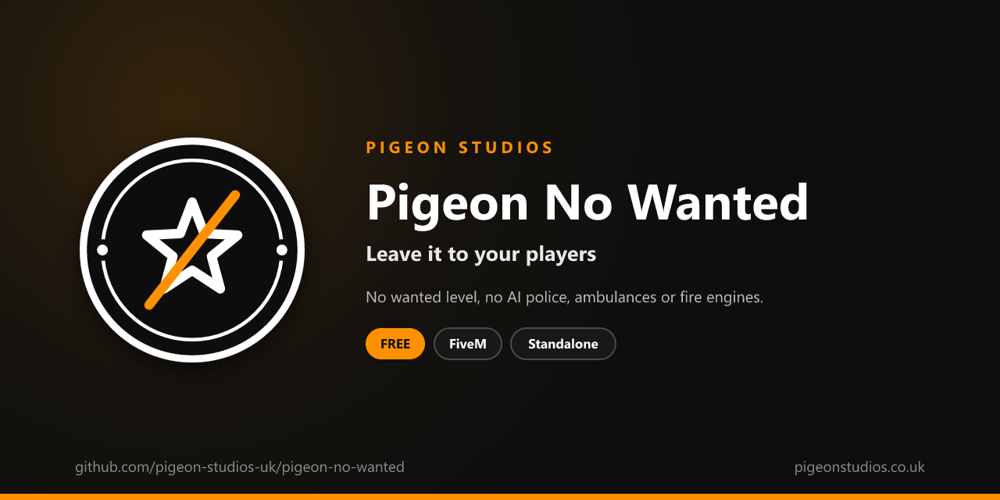

<div align="center">
  

  <h1>Pigeon No Wanted</h1>

  <p><strong>Turns off GTA's wanted level, AI police and the AI ambulances and fire engines, with each service chosen in the config.</strong></p>

  <p>
    <a href="https://github.com/pigeon-studios-uk/pigeon-no-wanted/releases/latest"></a>
    <a href="LICENSE.md"></a>
    <a href="https://discord.gg/2NFVWEUmDF"></a>
    
  </p>

  <p>
    <a href="https://github.com/pigeon-studios-uk/pigeon-no-wanted/releases/latest"><strong>Download</strong></a> ·
    <a href="#installation">Install</a> ·
    <a href="#configuration">Configure</a> ·
    <a href="CHANGELOG.md">Changelog</a> ·
    <a href="https://discord.gg/2NFVWEUmDF">Support</a>
  </p>
</div>

---

## Contents

- [Overview](#overview)
- [Features](#features)
- [Requirements](#requirements)
- [Installation](#installation)
- [Updating](#updating)
- [Configuration](#configuration)
- [How it works](#how-it-works)
- [Update checker](#update-checker)
- [Performance](#performance)
- [Security](#security)
- [Troubleshooting](#troubleshooting)
- [FAQ](#faq)
- [Support](#support)
- [Contributing](#contributing)
- [Licence](#licence)
- [Credits](#credits)

## Overview

Pigeon No Wanted is a free resource by [Pigeon Studios](https://pigeonstudios.co.uk) that turns off GTA's wanted level and the AI services that come with it. In GTA, crimes give a player stars, and the game sends AI police cars, helicopters, SWAT and even the army after them. It also sends AI ambulances and fire engines to anyone hurt and any fire. On roleplay servers, where your players are the police, EMS and fire service, that AI gets in the way of every scene.

With this resource, players never get a wanted level, and GTA doesn't send its own emergency services. You choose each service, so you can keep, say, the AI ambulances if you have no EMS players.

## Features

- **No wanted level.** Or a cap you choose, from 0 to 5 stars.
- **No AI police.** Cars, bikes, boats, helicopters, roadblocks, SWAT and the army, each turned off on its own.
- **No AI ambulances or fire engines.** They stop turning up to every injury and fire.
- **No gang responses.** Gang members stop coming out after shooting in their area.
- **No random police NPCs.** Optional: no police walking, standing or driving around.
- **AI police ignore players.** They don't chase or shoot players for crimes they see.
- **Your players untouched.** Only GTA's AI is changed. Your police, EMS and fire jobs work as normal.
- **Undoes itself.** Stopping the resource puts GTA's defaults back.
- **Standalone.** No framework or other resources needed.

## Requirements

| Requirement | Version | Notes |
|---|---|---|
| FXServer | A [recommended artifact](https://runtime.fivem.net/artifacts/) | |

**Frameworks:** none needed. It works the same on standalone servers, ESX Legacy, QBCore, Qbox and ox_core.

## Installation

1. **Download** `pigeon-no-wanted.zip` from the [latest release](https://github.com/pigeon-studios-uk/pigeon-no-wanted/releases/latest). Don't use the green **Code** button; release zips are the tested builds.
2. **Extract** it into your server's `resources` folder. The folder must be called `pigeon-no-wanted`.
3. **Start it** by adding this to `server.cfg`:

   ```cfg
   ensure pigeon-no-wanted
   ```

4. **Configure** it in `configuration/config.lua` if you want to change anything. The defaults work as they are.
5. **Restart** your server. The console shows one line from the update checker:

   ```text
   [Pigeon Studios] Pigeon No Wanted v1.0.0 is up to date.
   ```

## Updating

1. Read the [changelog](CHANGELOG.md) for every version between yours and the latest, especially any **Upgrade notes**.
2. Back up your `configuration/` folder.
3. Replace the `pigeon-no-wanted` folder with the new release.
4. Copy your changed settings into the new `configuration/config.lua`. Don't copy the old file over the new one; new versions can add settings.
5. Restart the resource.

## Configuration

All settings are in `configuration/config.lua`, each explained by a comment next to it.

| Setting | Default | What it does |
|---|---|---|
| `Config.MaxWantedLevel` | `0` | Highest wanted level a player can get, from 0 to 5 |
| `Config.PoliceIgnorePlayers` | `true` | AI police don't react to players' crimes |
| `Config.RandomCops` | `false` | `false`: no random police NPCs. `true` leaves them as GTA has them |
| `Config.Services` | all `false` | GTA's AI services, each `false` (off) or `true` (kept): see below |
| `Config.ReapplySeconds` | `1.0` | How often the settings are applied again |

The services in `Config.Services`:

| Service | What GTA sends |
|---|---|
| `police_cars` | Police cars after a wanted player |
| `police_helicopters` | Police helicopters |
| `police_bikes` | Police on motorbikes |
| `police_boats` | Police boats |
| `police_backup` | Extra units called in by police already chasing |
| `police_patrols` | Police that cruise after a wanted player |
| `police_pull_overs` | Police that wait for a wanted player to pull over |
| `roadblocks` | Police roadblocks |
| `swat_vans` | SWAT vans |
| `swat_helicopters` | SWAT helicopters |
| `army` | The army, at the highest wanted levels |
| `ambulances` | Ambulances that turn up when someone's hurt |
| `fire_engines` | Fire engines that turn up to fires |
| `gangs` | Gang members that respond to shooting in their area |

## How it works

Everything here is a game setting in each player's own game:

- `SetMaxWantedLevel` caps the wanted level, and anything above it is cleared at once.
- `SetPoliceIgnorePlayer` makes AI police ignore the player.
- `EnableDispatchService` turns each of GTA's AI services on or off, and `SetDispatchCopsForPlayer` stops police being sent for the player.
- `SetCreateRandomCops` and the two scenario versions stop GTA spawning random police NPCs.

GTA and other resources can change these back, so they're applied again every `Config.ReapplySeconds`, and straight away when a player spawns. When the resource stops, GTA's defaults are put back.

## Update checker

When it starts, Pigeon No Wanted checks our public [version registry](https://github.com/pigeon-studios-uk/pigeon-versions) once and prints one line in the server console saying whether it's up to date. If there's an update, it shows what's new and where to get it. The check is a single request to GitHub and sends nothing about your server or players.

Control it for every Pigeon Studios resource at once in `server.cfg`:

```cfg
set pigeon_update_check "on"      # default: one line per resource
set pigeon_update_check "quiet"   # only when there's an update or a problem
set pigeon_update_check "off"     # never check
```

## Performance

It sets a handful of game settings once a second and does nothing else. Nothing runs every frame, and nothing runs on the server apart from the update check at start-up.

## Security

- It runs only in each player's own game and only changes GTA's AI and that player's wanted level.
- It has no commands, exports or network events, so there is nothing other players, other resources or the server can send it.
- The only network request is the update check at start-up, from the server to GitHub. It sends nothing about your server or players.
- It switches off GTA's AI; it isn't an anti-cheat, and a player with a modified game could switch it back for themselves.

Found a problem? Please don't open a public issue. Use the **Report a vulnerability** button in this repository's **Security** tab, or follow our [Security Policy](https://github.com/pigeon-studios-uk/.github/blob/main/SECURITY.md).

## Troubleshooting

**Players still get a wanted level.**
Check the resource is started and there are no errors in the F8 console. Another resource that sets the wanted level itself, such as a heist script, can fight with it; set `Config.MaxWantedLevel` to the highest level that resource needs.

**AI police still turn up.**
Check every police service in `Config.Services` is `false`. Police NPCs already walking or driving around before you started the resource stay until GTA removes them.

**I want the AI ambulances back.**
Set `ambulances = true` in `Config.Services`.

**The console says "isn't in the version registry" or "couldn't check for updates".**
Your server couldn't reach GitHub, or the check is blocked by a firewall. The resource works normally either way. Turn the check off with `set pigeon_update_check "off"`.

## FAQ

**Is it really free?**
Yes. Use it on as many servers as you like, including ones that take donations. You just can't reupload, resell or bundle it. See [Licence](#licence).

**Does it affect my police, EMS or fire players?**
No. It only changes GTA's own AI. Your jobs, dispatch and MDT resources work as normal.

**Does it remove the police stations or their NPCs?**
It stops random police NPCs spawning with `Config.RandomCops = false`. Buildings and props aren't changed.

**Can I reduce NPCs and traffic too?**
That's [Pigeon Population](https://github.com/pigeon-studios-uk/pigeon-population). For the distant sirens and police scanner, see [Pigeon Quiet City](https://github.com/pigeon-studios-uk/pigeon-quiet-city).

## Support

Read [Troubleshooting](#troubleshooting) first, then ask in the support channels of our [Discord](https://discord.gg/2NFVWEUmDF). Please include your Pigeon No Wanted version, FXServer artifact and any errors from the console. See [Getting help](https://github.com/pigeon-studios-uk/.github/blob/main/SUPPORT.md).

Found a bug? Open a [bug report](https://github.com/pigeon-studios-uk/pigeon-no-wanted/issues/new/choose).

## Contributing

Fixes, improvements and translations are welcome. Please read the [contributing guide](https://github.com/pigeon-studios-uk/.github/blob/main/CONTRIBUTING.md) first, and open a feature request before working on anything big.

## Licence

Pigeon No Wanted is free to use under the **[Pigeon Studios Free Licence](LICENSE.md)**.

- ✅ Use it on any number of servers, including monetised ones
- ✅ Change it for your own servers
- ✅ Show it in videos and streams
- ❌ Don't reupload, share or mirror the files; link to this repository instead
- ❌ Don't sell it, bundle it in packs, or put it behind escrow
- ❌ Don't remove the credits

This summary isn't the licence; [LICENSE.md](LICENSE.md) is. Third-party notices are in [NOTICE.md](NOTICE.md).

## Credits

Made by [Pigeon Studios](https://pigeonstudios.co.uk).

<sub>Not affiliated with or endorsed by Rockstar Games, Take-Two Interactive or Cfx.re.</sub>
